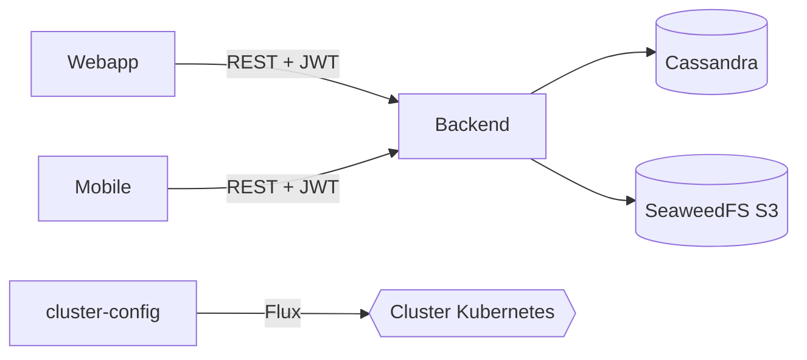

# Twitter - Grupo 5 (Configuración del cluster)

## Integrantes

- Ramírez Victor
- Rando Tomás
- Ruiz Joaquín
- Castinelli Leonel

## Descripción

Red social simplificada al estilo Twitter. Los usuarios se registran, inician sesión y publican mensajes de texto, imágenes o ambos en un feed común y paginado. La aplicación está disponible en versión web y móvil, que comparten cuentas y publicaciones a través del mismo backend. Todo corre en un cluster de Kubernetes administrado con GitOps (Flux).

Este repositorio contiene la **configuración GitOps del cluster**. No incluye código de aplicación: las imágenes del frontend y del backend se generan en sus propios repositorios.

## Repositorios

- [grupo5-webapp](https://github.com/FING-middlewares-distribuidos-2026/grupo5-webapp): frontend web.
- [grupo5-mobile](https://github.com/FING-middlewares-distribuidos-2026/grupo5-mobile): aplicación móvil.
- [grupo5-backend](https://github.com/FING-middlewares-distribuidos-2026/grupo5-backend): API REST.
- [grupo5-middlewares-cluster-config](https://github.com/FING-middlewares-distribuidos-2026/grupo5-middlewares-cluster-config): configuración del cluster (GitOps).

## Diseño

El sistema se compone de cuatro componentes desarrollados por nosotros:

- **Webapp**: SPA en React + Vite, servida por nginx. Maneja el login/registro, el feed paginado y la creación de publicaciones con imagen. Se comunica con el backend mediante REST y un JWT Bearer.
- **Mobile**: aplicación React Native / Expo para Android con las mismas funcionalidades que la web. Guarda el JWT en SecureStore y se distribuye como APK generado con EAS.
- **Backend**: API REST en Java 21 + Spring Boot. Gestiona usuarios, autenticación JWT y publicaciones. Persiste los datos en Cassandra y las imágenes en un almacenamiento compatible con S3. Escala horizontalmente con un HPA (de 1 a 5 réplicas según el uso de CPU).
- **middlewares-cluster-config**: repositorio GitOps con todos los manifiestos del cluster. Flux observa la rama `main` y aplica los cambios automáticamente, así que mergear un PR equivale a desplegar.

Componentes de terceros que se usan:

- **Flux**: GitOps.
- **MetalLB**: IPs fijas para los servicios `LoadBalancer`.
- **Cassandra** (cass-operator): base de datos (3 nodos).
- **SeaweedFS**: almacenamiento de objetos S3.
- **Prometheus, Alertmanager, Grafana, Loki, Alloy y Blackbox Exporter**: monitoreo, logs y alertas (con notificaciones a Telegram).
- **Actions Runner Controller (ARC)**: runners de GitHub Actions dentro del cluster.

### Uso

Desde la red de la facultad (o a través de la VPN o ZeroTier):

- Frontend: [http://10.66.51.52](http://10.66.51.52)
- Backend: `http://10.66.51.51:8080/api/v1`

### Despliegue

El despliegue se hace con **Flux**. Flux observa la rama `main` de este repositorio (cada 1 minuto) y aplica todo el contenido de `manifests/` con `prune: true`:

- Agregar un archivo YAML en `manifests/` lo despliega.
- Borrarlo elimina sus recursos del cluster.
- Todos los cambios entran por PR a `main`, así que mergear equivale a desplegar.

Los repositorios del backend y de la webapp publican una imagen versionada en GHCR en cada push a `main` y abren automáticamente un PR aquí que actualiza el tag de la imagen en `twitter-backend.yaml` o `twitter-frontend.yaml`.

Los servicios se exponen como `LoadBalancer` con IPs fijas del pool `twitter-pool` de MetalLB:

| Servicio | IP | Puerto |
|---|---|---|
| `twitter-backend` | 10.66.51.51 | 8080 |
| `twitter-frontend` | 10.66.51.52 | 80 |
